# 从裸机到多任务：STM32F103的uC/OS-III移植与AHT20采集实践

[TOC]

## 一、实验概述

### 1.1 实验背景

本次实验围绕STM32F103C8T6最小系统板展开，包含两个相互关联的任务。任务一要求将uC/OS-III实时操作系统移植到STM32F103上，并构建至少3个任务，分别完成LED周期控制和串口周期发送；任务二要求通过I2C总线完成AHT20温湿度传感器的数据采集，并把采集结果通过串口发送到上位机，同时观察I2C时钟线、数据线的时序波形，分析AHT20的器件地址与初始化命令。

两个任务并不是彼此孤立的。任务一解决的是“程序如何被RTOS组织起来”的问题，任务二解决的是“外设数据如何通过总线进入系统”的问题。把AHT20采集任务放进uC/OS-III的任务框架后，LED闪烁、串口输出和传感器采集可以并行运行，任务之间的时间关系也更加清晰。

### 1.2 实验目标

1. 掌握uC/OS-III在Cortex-M3内核上的移植方法，理解PendSV、SysTick和启动文件之间的关系。
2. 掌握uC/OS-III任务创建、优先级分配、任务延时和任务删除等基本操作。
3. 掌握STM32F103的GPIO、USART1和I2C1初始化方法，能够使用HAL库完成外设配置。
4. 理解软件I2C与硬件I2C的区别，能够根据AHT20数据手册完成初始化、触发测量、读取数据和CRC校验。
5. 能够使用Keil MDK的Logic Analyzer观察GPIO、串口和I2C波形，并依据波形分析I2C地址、命令和时序。
6. 能够记录实验过程中出现的真实问题，分析原因并给出可复现的解决办法。

### 1.3 实验环境

| 类别 | 内容 |
|---|---|
| 主控芯片 | STM32F103C8T6，ARM Cortex-M3内核，64KB Flash，20KB SRAM |
| 开发板 | STM32F103C8T6最小系统板 |
| 下载器 | DAP-Link，支持CMSIS-DAP SWD下载和USB虚拟串口 |
| 传感器 | AHT20温湿度传感器模块，I2C接口 |
| 串口工具 | SSCOM，115200bit/s、8数据位、1停止位、无校验            |

## 二、任务一：uC/OS-III移植与多任务设计

### 2.1 任务要求与总体设计

任务一要求以uC/OS为例，把实时操作系统移植到STM32F103上，并构建至少3个任务：第1个任务以1s周期控制LED点亮与熄灭，第2个任务以3s周期控制另一个LED，第3个任务以2s周期通过串口发送“hellouc/OS!欢迎来到RTOS多任务环境！”。

本实验采用“启动任务+3个应用任务”的结构。启动任务只负责初始化CPU库、配置uC/OS节拍、创建应用任务，然后删除自己；3个应用任务分别承担LED1、LED2和串口发送。这样可以把系统初始化和业务任务分开，避免在`main()`中直接创建全部任务造成职责混乱。

| 任务 | 优先级 | 周期 | 功能 |
|---|---:|---:|---|
| `start_task` | 2 | 只执行一次 | 初始化CPU库、配置SysTick、创建3个应用任务，然后删除自己 |
| `LED1` | 3 | 1s翻转一次 | PB0外接LED亮灭 |
| `LED2` | 4 | 3s翻转一次 | PB1外接LED亮灭 |
| `UART` | 5 | 2s | USART1发送指定字符串 |

任务栈大小分别为256、256、256和512个`CPU_STK`元素。LED任务只做GPIO翻转和系统延时，栈需求较小；串口任务调用`HAL_UART_Transmit()`，需要更大的栈空间。

### 2.2 uC/OS-III移植过程

#### 2.2.1 移植文件组成

工程中的uC/OS-III主要包括：

- `uC-OS3/Source/`：uC/OS-III内核源码，包括`os_core.c`、`os_task.c`、`os_time.c`、`os_tick.c`、`os_var.c`等。
- `uC-OS3/Ports/ARM-Cortex-M/ARMv7-M/`：Cortex-M3端口层，包括`os_cpu_a.asm`、`os_cpu_c.c`和`os_cpu.h`。
- `uC-CPU/`：CPU底层库和Cortex-M3端口，包括`cpu_a.asm`、`cpu_c.c`、`cpu_core.c`。
- `uC-LIB/`：uC/OS自带的基础库。
- `Cfg/Template/`：`os_cfg.h`、`os_cfg_app.h`、`cpu_cfg.h`、`lib_cfg.h`等配置文件。

移植时没有修改内核的业务逻辑，主要工作是补齐编译器、启动文件、时钟节拍和中断向量之间的接口。

#### 2.2.2 PendSV与启动文件

Cortex-M3的上下文切换依赖PendSV异常。uC/OS-III的`os_cpu_a.asm`导出了`OS_CPU_PendSVHandler`，因此启动文件`startup_stm32f103xb.s`中的PendSV向量必须指向它：

```asm
DCD     OS_CPU_PendSVHandler       ; uC/OS-III PendSV Handler
```

如果仍然指向默认的`PendSV_Handler`，系统第一次任务切换时就会进入启动文件里的弱定义死循环，表现为程序“跑不起来”或直接卡死。这一点是uC/OS-III移植中最容易遗漏的环节之一。

#### 2.2.3 SysTick节拍

uC/OS-III需要1ms的系统节拍，同时HAL库的`HAL_Delay()`和`HAL_GetTick()`也依赖SysTick。工程让二者共用同一个SysTick中断，并在中断中先累加HAL节拍，再在系统启动后调用uC/OS的节拍处理函数：

```c
void SysTick_Handler(void)
{
    HAL_IncTick();

    if (OSRunning == OS_STATE_OS_RUNNING) {
        OS_CPU_SysTickHandler();
    }
}
```

`OSRunning`的判断非常关键。`OSStart()`之前系统还没有开始调度，如果此时调用`OS_CPU_SysTickHandler()`，内核对象尚未完全初始化，容易进入异常。启动任务中再调用：

```c
CPU_Init();
OS_CPU_SysTickInit(SystemCoreClock / OS_CFG_TICK_RATE_HZ);
```

把SysTick重装载值配置为72000，得到1ms节拍；同时把SysTick优先级设置为内核配置允许的范围。这样HAL库的阻塞延时和uC/OS的任务延时可以同时工作。

#### 2.2.4 内核配置裁剪

本实验没有使用事件标志、内存管理、互斥信号量、消息队列、信号量、软件定时器和统计任务，因此在`os_cfg.h`中关闭了这些功能，只保留任务管理、时间管理、节拍和必要的对象检查。这样既能减小Flash占用，也能减少RAM开销，更适合STM32F103C8T6的64KB Flash和20KB SRAM。

### 2.3 时钟、GPIO与USART1配置

#### 2.3.1 时钟配置

系统时钟采用HSE 8MHz经PLL×9得到72MHz，AHB不分频，APB1二分频为36MHz，APB2不分频为72MHz。CubeMX中的RCC配置和时钟树分别如下所示。

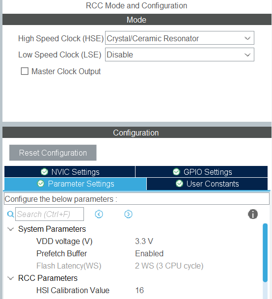

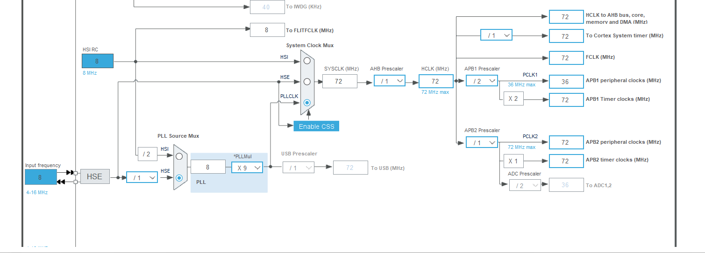

#### 2.3.2 调试接口配置

SYS配置选择Serial Wire，保留PA13、PA14作为SWDIO、SWCLK，关闭JTAG以释放相关引脚。DAP-Link通过SWD接口完成下载和调试。

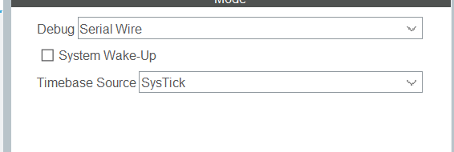

#### 2.3.3 GPIO配置

两个LED都接在面包板上。LED1接PB0，LED2接PB1，均采用高电平点亮，因此初始化时把PB0、PB1都输出低电平，LED初始为灭。CubeMX中的GPIO配置如下所示。

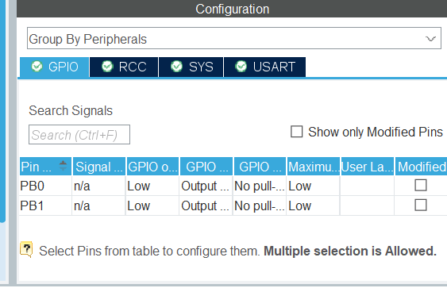

#### 2.3.4 USART1配置

USART1使用PA9作为TX、PA10作为RX，参数为115200bit/s、8数据位、1停止位、无校验、无硬件流控。DAP-Link的RXD接PA9，TXD接PA10，二者交叉连接，并且必须共地。

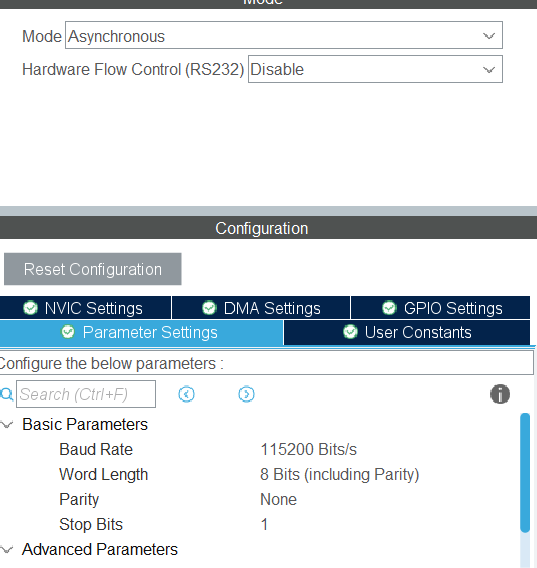

### 2.4 任务代码实现

任务创建集中在`start_task()`中，下面给出LED任务和串口任务的关键代码：

```c
static void led1_task(void *p_arg)
{
    OS_ERR err;
    (void)p_arg;

    for (;;) {
        HAL_GPIO_TogglePin(GPIOB, GPIO_PIN_0);
        OSTimeDlyHMSM(0u, 0u, 1u, 0u, OS_OPT_TIME_HMSM_STRICT, &err);
    }
}

static void led2_task(void *p_arg)
{
    OS_ERR err;
    (void)p_arg;

    for (;;) {
        HAL_GPIO_TogglePin(GPIOB, GPIO_PIN_1);
        OSTimeDlyHMSM(0u, 0u, 3u, 0u, OS_OPT_TIME_HMSM_STRICT, &err);
    }
}

static void uart_task(void *p_arg)
{
    OS_ERR err;
    (void)p_arg;

    for (;;) {
        BSP_UART_SendString(hello_msg);
        OSTimeDlyHMSM(0u, 0u, 2u, 0u, OS_OPT_TIME_HMSM_STRICT, &err);
    }
}
```

`OSTimeDlyHMSM()`的参数依次为小时、分钟、秒、毫秒和选项。这里使用`OS_OPT_TIME_HMSM_STRICT`，表示按严格时间格式进行延时。任务函数都写成无限循环，uC/OS-III会在每次延时期间切换到其他就绪任务。

串口发送内容通过GBK字节数组给出，避免源文件编码和ARMCC编译环境不一致导致中文乱码：

```c
static const char hello_msg[] =
    "hello uc/OS! "
    "\xBB\xB6\xD3\xAD\xC0\xB4\xB5\xBD"              /* 欢迎来到 */
    "RTOS"
    "\xB6\xE0\xC8\xCE\xCE\xF1\xBB\xB7\xBE\xB3"      /* 多任务环境 */
    "\xA3\xA1\r\n";
```

### 2.5 硬件连接

任务一的硬件连接如下：

| STM32F103C8T6引脚 | 连接对象 | 说明 |
|---|---|---|
| PB0 | LED1正极经330Ω到PB0，负极到GND | 高电平点亮 |
| PB1 | LED2正极经330Ω到PB1，负极到GND | 高电平点亮 |
| PA9 | DAP-Link RXD | USART1_TX |
| PA10 | DAP-Link TXD | USART1_RX |
| PA13 | DAP-Link SWDIO | SWD数据 |
| PA14 | DAP-Link SWCLK | SWD时钟 |
| GND               | DAP-Link GND、LED负极          | 必须共地   |

实物连接如图6所示。面包板上两个LED分别对应PB0和PB1，DAP-Link通过排线连接SWD和串口。


### 2.6 编译与运行结果

任务一工程在Keil MDK中编译结果为0 Error、0 Warning。程序下载后可以观察到：

- PB0上的LED1每1s翻转一次，即亮1s、灭1s；
- PB1上的LED2每3s翻转一次；
- USART1每2s输出一次指定字符串。

串口输出内容为：

```text
hello uc/OS! 欢迎来到RTOS多任务环境！
```

实验效果会放在最后或者单独压缩包

### 2.7 任务一中的问题与处理

#### 2.7.1 LED从板载改为外接

最初使用PC13板载LED进行验证，但任务要求两个LED都外接。于是把LED1改到PB0、LED2改到PB1，并在`main.c`中集中定义：

```c
#define LED1_GPIO_PORT   GPIOB
#define LED1_GPIO_PIN    GPIO_PIN_0
#define LED2_GPIO_PORT   GPIOB
#define LED2_GPIO_PIN    GPIO_PIN_1
```

这样只需要修改宏定义就能更换引脚，避免在任务函数和初始化函数中分别修改，减少遗漏。

#### 2.7.2 串口中文乱码

最初串口输出中文出现乱码。原因是源文件使用UTF-8编码，而串口助手按GBK解释字节。后来把要发送的中文直接写成GBK字节转义，并在`main.c`中提供宏：

```c
#define UART_MSG_USE_GBK   1
```

当宏为1时发送GBK字节，SSCOM/XCOM使用默认GBK编码即可正常显示；如果串口助手只支持UTF-8，把宏改为0，重新编译并把串口助手切换为UTF-8。这个问题说明：串口显示是否正确不仅取决于波特率，还取决于发送端和接收端的字符编码是否一致。

## 三、任务二：AHT20温湿度采集与I2C时序分析

### 3.1 任务要求

任务二要求使用STM32F103完成基于I2C协议的AHT20温湿度传感器数据采集，并把温度、湿度通过串口输出。具体包括：

1. 解释软件I2C和硬件I2C。
2. 阅读AHT20数据手册，每2s采集一次温湿度，通过串口发送到上位机。
3. 在任务一的多任务程序基础上，把第3个任务改为每2s采集一次AHT20。
4. 用示波器或Keil虚拟逻辑分析仪观察I2C时钟线和数据线，记录并分析时序协议，说明AHT20的I2C地址和初始化命令。

### 3.2 软件I2C与硬件I2C

#### 3.2.1 硬件I2C

硬件I2C使用STM32芯片内部集成的I2C外设。配置好`I2C_CR2`、`I2C_CCR`、`I2C_TRISE`等寄存器后，起始位、地址、应答位、时钟脉冲和停止位由硬件产生。CPU只需要读写数据寄存器并检查状态标志，因而CPU占用较低，时序稳定，适合较高频率和中断/DMA方式。

硬件I2C的缺点是引脚基本固定。本实验使用I2C1的PB6、PB7，不能随意改到其他引脚；此外，不同STM32系列的I2C外设存在差异，调试时需要关注状态标志和错误标志。

#### 3.2.2 软件I2C

软件I2C又称bit-bang I2C，用两个普通GPIO模拟SCL和SDA。代码手动控制引脚电平，产生起始条件、数据位、应答位和停止条件。软件I2C的优点是引脚选择灵活、时序直观，适合理解协议和移植；缺点是占用CPU，SCL频率受延时和中断影响，通常只能做到几十kHz。

本实验的真实硬件工程`AHT20_Bare`和`AHT20_uCOSIII`使用硬件I2C1，配置为100kHz；`AHT20_Sim`为了在Keil中产生可观察的波形，使用软件I2C。两者实现的是同一个I2C协议，但用途不同。

### 3.3 AHT20数据手册要点

根据AHT20产品规格书和公开模块资料，AHT20的主要特性如下：

| 项目 | 内容 |
|---|---|
| 通信接口 | 标准I2C，7位地址0x38 |
| 写地址 | 0x70（0x38左移一位，最低位0） |
| 读地址 | 0x71（0x38左移一位，最低位1） |
| 温度范围 | -40～85℃ |
| 湿度范围 | 0～100%RH |
| 供电 | 模块通常支持较宽电压，本实验统一使用3.3V |
| 数据长度 | 每次读取7字节：状态+湿度20bit+温度20bit+CRC |

AHT20上电后需要等待至少40ms。程序先读取状态字节，如果状态字节的bit3为0，表示器件尚未校准，需要发送初始化命令：

```text
0xBE 0x08 0x00
```

如果bit3已经为1，则不需要再次发送初始化命令。触发一次测量时发送：

```text
0xAC 0x33 0x00
```

AHT20完成一次转换需要一定时间，数据手册给出的典型等待时间为80ms。转换完成后读取7个字节，第1字节为状态，中间5字节包含20位湿度和20位温度，最后1字节为CRC校验值。状态字节bit7为1表示器件忙，数据无效；CRC8多项式为0x31，初值为0xFF。

湿度与温度的换算公式为：

```text
RH  = raw_humi / 2^20 × 100%
T   = raw_temp / 2^20 × 200 - 50℃
```

### 3.4 硬件设计

AHT20模块与STM32F103的连接如下：

| AHT20引脚 | STM32F103C8T6 | 说明 |
|---|---|---|
| VDD/VCC | 3.3V | 不要接5V |
| GND | GND | 与单片机共地 |
| SCL | PB6 | I2C1_SCL |
| SDA | PB7 | I2C1_SDA |

DAP-Link的串口与SWD连接方式与任务一相同：PA9接DAP-Link RXD，PA10接DAP-Link TXD，PA13接SWDIO，PA14接SWCLK，GND共地。核心板已经由USB供电时，不要再把DAP-Link的3.3V接到核心板3.3V，避免两个电源顶在一起。

实物连接如图所示。图中可以看到STM32F103C8T6最小系统板、AHT20模块、DAP-Link以及两个外接LED。

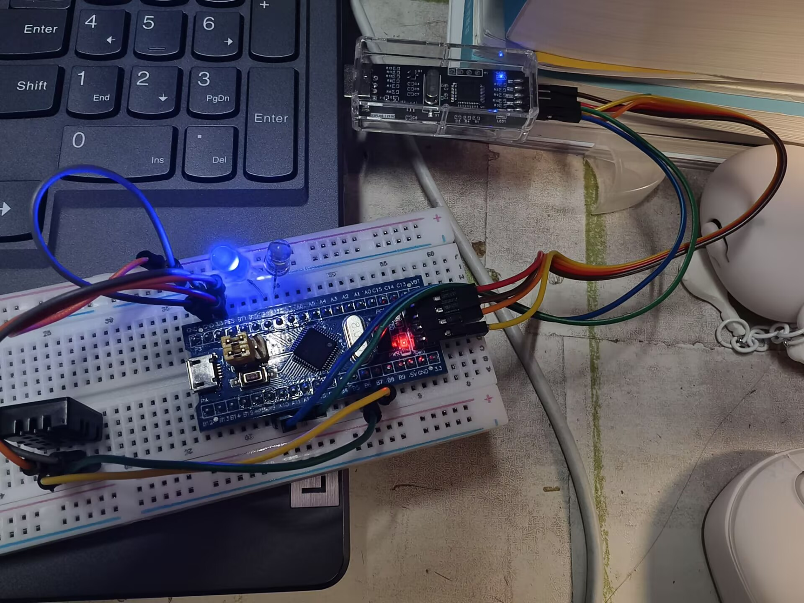

### 3.5 CubeMX配置

任务二的CubeMX配置包括RCC、SYS、USART1、I2C1和时钟树。

#### 3.5.1 RCC与SYS

RCC选择HSE外部晶振，SYS选择Serial Wire。配置分别如下所示。

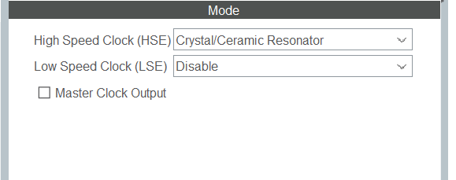

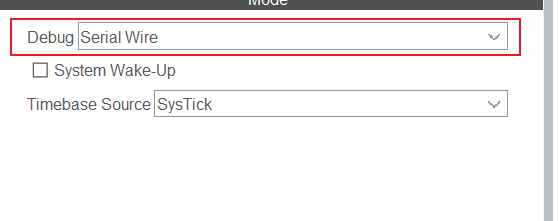

#### 3.5.2 USART1

USART1配置为异步模式，115200bit/s、8数据位、1停止位、无校验、无硬件流控，如图所示。

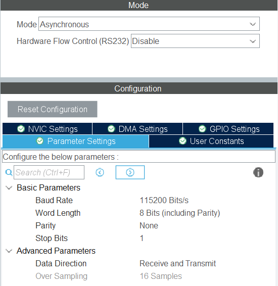

#### 3.5.3 I2C1

I2C1使用PB6作为SCL、PB7作为SDA，标准模式100kHz，7位地址，关闭双地址和通用呼叫，如图所示。

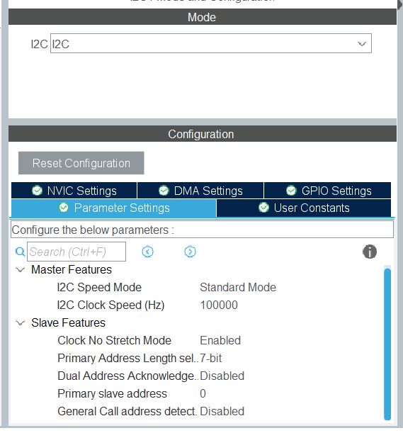

#### 3.5.4 时钟树

时钟树同样为HSE 8MHz经PLL×9得到72MHz，APB1为36MHz，APB2为72MHz，如图所示。

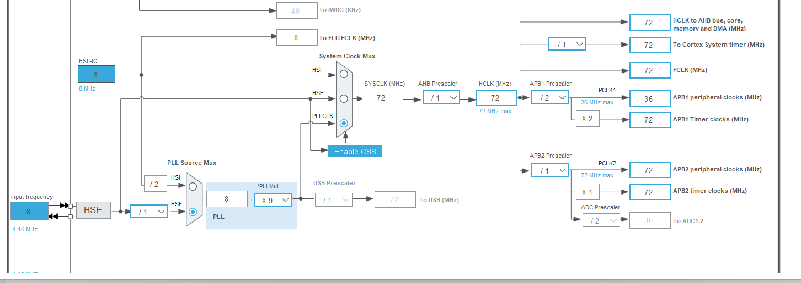

### 3.6 AHT20驱动实现

#### 3.6.1 初始化

`AHT20_Init()`先等待40ms，再读取状态字节，根据bit3判断是否需要发送初始化命令：

```c
HAL_Delay(40u);

if (HAL_I2C_Master_Receive(hi2c, AHT20_I2C_ADDR8, &status, 1u, 100u) != HAL_OK) {
    return HAL_ERROR;
}

if ((status & 0x08u) == 0u) {
    uint8_t cmd[3] = {0xBEu, 0x08u, 0x00u};
    if (HAL_I2C_Master_Transmit(hi2c, AHT20_I2C_ADDR8, cmd, 3u, 100u) != HAL_OK) {
        return HAL_ERROR;
    }
    HAL_Delay(10u);
}
```

`AHT20_I2C_ADDR8`定义为`0x38 << 1`，即0x70。HAL库的`HAL_I2C_Master_Transmit()`和`HAL_I2C_Master_Receive()`使用8位地址，因此代码中写0x70，读操作自动使用0x71。

#### 3.6.2 触发测量与读取

`AHT20_Read()`发送`0xAC 0x33 0x00`，等待80ms，再读取7字节：

```c
uint8_t cmd[3] = {0xACu, 0x33u, 0x00u};
uint8_t buf[7] = {0};

if (HAL_I2C_Master_Transmit(hi2c, AHT20_I2C_ADDR8, cmd, 3u, 100u) != HAL_OK) {
    return HAL_ERROR;
}

HAL_Delay(80u);

if (HAL_I2C_Master_Receive(hi2c, AHT20_I2C_ADDR8, buf, 7u, 100u) != HAL_OK) {
    return HAL_ERROR;
}
```

读取后先判断忙标志和CRC：

```c
if ((buf[0] & 0x80u) != 0u) {
    return HAL_BUSY;
}

if (AHT20_CRC8(buf, 6u) != buf[6]) {
    return HAL_ERROR;
}
```

#### 3.6.3 数据换算

湿度和温度的原始数据都是20位，需要按位拼接：

```c
raw_humi = ((uint32_t)buf[1] << 12) |
           ((uint32_t)buf[2] << 4)  |
           ((uint32_t)buf[3] >> 4);

raw_temp = (((uint32_t)buf[3] & 0x0Fu) << 16) |
           ((uint32_t)buf[4] << 8) |
           (uint32_t)buf[5];

data->humidity    = ((float)raw_humi * 100.0f) / 1048576.0f;
data->temperature = ((float)raw_temp * 200.0f) / 1048576.0f - 50.0f;
```

这段代码对应数据手册的转换公式。由于使用浮点数，串口打印前先把温度、湿度各放大10倍并四舍五入，再按整数和小数部分输出，避免依赖`printf`的浮点格式化支持。

### 3.7 裸机工程AHT20_Bare

`AHT20_Bare`是最基础的任务二实现。`main()`完成HAL、时钟、串口和I2C初始化后，先调用`AHT20_Init()`，然后进入主循环：

```c
for (;;) {
    if (!ready) {
        ready = (AHT20_Init(&hi2c1) == HAL_OK) ? 1u : 0u;
    }

    if (ready) {
        AHT20_Data_t data;
        HAL_StatusTypeDef st = AHT20_Read(&hi2c1, &data);
        if (st == HAL_OK) {
            Print_AHT20(&data);
        } else {
            BSP_UART_SendString("[AHT20] read failed (NACK/CRC/busy)\r\n");
            if (st != HAL_BUSY) {
                ready = 0u;
            }
        }
    }

    HAL_Delay(2000u);
}
```

如果初始化失败，程序会在下一次循环重新尝试；如果读取失败且不是忙状态，则清除`ready`，下一次重新初始化。这样即使传感器接触不良，程序也不会停在死循环里。

串口输出格式为：

```text
Temperature: 25.6 C   Humidity: 55.3 %RH
```

具体温湿度数值随环境变化。实验效果视频在报告末尾的效果展示部分插入。

### 3.8 多任务工程AHT20_uCOSIII

`AHT20_uCOSIII`在任务一的基础上把第3个任务从“串口周期发送”改为“AHT20采集”。任务表和任务一相同，只是第3个任务改为`aht20_task`，优先级仍为5，栈大小增加到512个`CPU_STK`元素，以容纳AHT20驱动和`snprintf`调用。

```c
static void aht20_task(void *p_arg)
{
    OS_ERR err;
    uint8_t ready = 0u;

    (void)p_arg;

    for (;;) {
        if (!ready) {
            if (AHT20_Init(&hi2c1) == HAL_OK) {
                ready = 1u;
                BSP_UART_SendString("[AHT20] init OK\r\n");
            } else {
                BSP_UART_SendString("[AHT20] init FAILED, check wiring\r\n");
            }
        }

        if (ready) {
            AHT20_Data_t data;
            HAL_StatusTypeDef st = AHT20_Read(&hi2c1, &data);
            if (st == HAL_OK) {
                Print_AHT20(&data);
            } else {
                BSP_UART_SendString("[AHT20] read failed (NACK/CRC/busy)\r\n");
                if (st != HAL_BUSY) {
                    ready = 0u;
                }
            }
        }

        OSTimeDlyHMSM(0u, 0u, 2u, 0u, OS_OPT_TIME_HMSM_STRICT, &err);
    }
}
```

这样两个LED任务和AHT20任务可以并行运行：LED1每1s翻转，LED2每3s翻转，AHT20每2s采集一次并打印。AHT20任务调用`HAL_Delay()`等待40ms和80ms时，SysTick仍会为uC/OS提供节拍，其他更高优先级任务可以抢占，因此不会因为传感器转换等待而完全阻塞LED闪烁。

### 3.9 Keil虚拟逻辑分析仪波形观察

#### 3.9.1 最初的问题：只有直线

最初直接在`AHT20_uCOSIII`工程中使用Keil的Logic Analyzer观察PB6、PB7，结果只有两条直线，如图13所示。

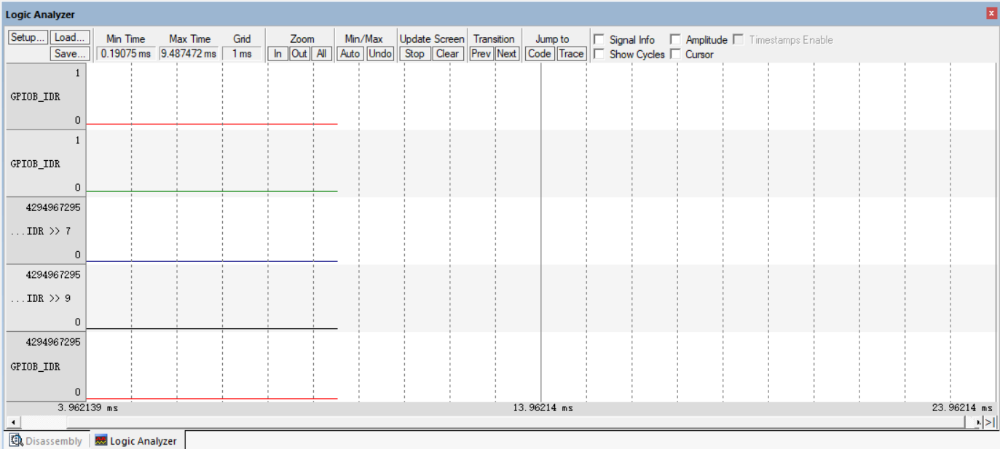

检查代码后确认，硬件I2C的初始化、地址和命令都没有问题。真正原因是：Keil的Simulator没有AHT20从机模型，硬件I2C外设发出起始条件和地址后，等不到AHT20的ACK，`HAL_I2C_Master_Transmit()`无法完成正常总线握手，因此PB6、PB7不会产生完整的I2C波形。这个现象是仿真环境限制，不是真实硬件上的代码错误。

#### 3.9.2 用于波形观察的AHT20_Sim

为了在不改变真实硬件工程的前提下完成波形观察，新增了`AHT20_Sim`工程。该工程把PB6、PB7配置为开漏输出，用软件I2C产生起始条件、地址、数据、ACK和停止条件，并把引脚电平同步到一个32位变量`g_la`的bit6、bit7，方便Keil的Logic Analyzer读取。

```c
volatile uint32_t g_la = 0u;

static void scl_high(void)
{
    g_la |= (1u << 6);
    HAL_GPIO_WritePin(GPIOB, GPIO_PIN_6, GPIO_PIN_SET);
}

static void scl_low(void)
{
    g_la &= ~(1u << 6);
    HAL_GPIO_WritePin(GPIOB, GPIO_PIN_6, GPIO_PIN_RESET);
}
```

SDA使用bit7，代码结构相同。`AHT20_Sim`每个2s执行一次完整的初始化、测量和读取序列，波形中包含：

```text
START + 0x70 + 0xBE 0x08 0x00 + STOP
START + 0x70 + 0xAC 0x33 0x00 + STOP
START + 0x71 + 7字节 + STOP
```

在Keil中打开`AHT20_Sim.uvprojx`，选择Use Simulator，进入调试后打开Logic Analyzer，添加`g_la`，设置`And Mask`为0x40、`Shift Right`为6得到SCL，再添加一次`g_la`，设置0x80、7得到SDA。运行后可以看到图14和图15的波形。

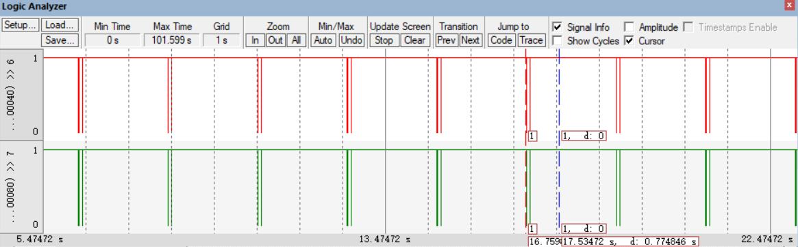

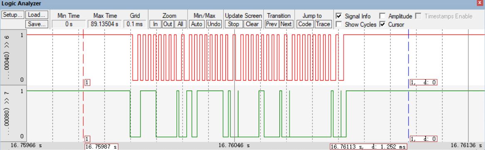

#### 3.9.3 波形分析

波形图的时间轴跨度较大，可以看到大约每2s出现一组波形，说明采集周期为2s，符合任务要求。后一张图是局部放大图，能够看到SCL连续时钟脉冲和SDA数据变化。

一个完整的I2C字节包括8个数据位和1个应答位，因此每个字节对应9个SCL周期。波形中的起始条件表现为SCL为高时SDA由高变低，停止条件表现为SCL为高时SDA由低变高。数据位在SCL低电平期间改变，在SCL高电平期间保持稳定，接收方在SCL高电平期间采样。

软件I2C的SCL频率由`i2c_delay()`的循环次数决定。当前延时下波形频率约为十几kHz，低于100kHz，但AHT20可以接受这个速率，协议分析不受影响。如果要接近100kHz，可以把`i2c_delay()`中的80改小。

#### 3.9.4 AHT20地址与命令分析

结合数据手册和波形，可以得到以下数据

| 项目 | 数值/说明 |
|---|---|
| AHT20的7位I2C地址 | 0x38 |
| 写地址（8位） | 0x70 |
| 读地址（8位） | 0x71 |
| 初始化命令 | 0xBE 0x08 0x00，仅在状态字节bit3=0时发送 |
| 触发测量命令 | 0xAC 0x33 0x00 |
| 读取长度 | 7字节：状态+湿度+温度+CRC |

从波形上读地址时，第一个字节0x70对应二进制`01110000`，最低位0表示写；读操作使用0x71，最低位1表示读。初始化阶段的`0xBE 0x08 0x00`用于校准/初始化，测量阶段的`0xAC 0x33 0x00`用于触发一次温湿度转换。

### 3.10 任务二运行结果

真实硬件工程运行时，串口每2s输出一行温湿度数据。裸机工程输出格式为：

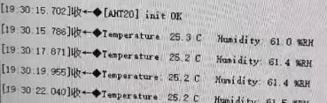

接入AHT20后，如果初始化成功，串口会打印`[AHT20] init OK`；如果接线或上拉有问题，会打印`[AHT20] init FAILED`或`[AHT20] read failed`，程序会自动重试。

### 3.11 任务二中的问题与处理

#### 3.11.1 仿真波形只有直线

原因不是I2C代码错误，而是KeilSimulator没有AHT20从机模型，硬件I2C无法完成ACK握手。解决方法是新增`AHT20_Sim`，用软件I2C产生波形；真实硬件仍然使用硬件I2C的`AHT20_Bare`和`AHT20_uCOSIII`。

#### 3.11.2 GPIOB_ODR无法添加

在Keil Logic Analyzer中直接输入`GPIOB_ODR`或`PORTB`时，可能提示`Unknown Signal`，因为当前Keil版本不允许把SFR直接作为逻辑分析仪信号。解决办法是使用普通全局变量`g_la`，它是32位变量，Logic Analyzer可以正常读取；bit6对应SCL，bit7对应SDA。

#### 3.11.3 串口数据格式

串口输出使用115200bit/s、8数据位、1停止位、无校验。温度、湿度均保留1位小数，单位分别为℃和%RH。若串口助手显示乱码，应检查编码设置；本工程任务二的输出主要是英文，编码影响较小。

## 四、实验总结

本次实验完成了从RTOS移植到I2C传感器采集的完整流程。任务一的核心不是简单调用几个API，而是理解uC/OS-III与Cortex-M3内核之间的接口：PendSV负责上下文切换，SysTick负责系统节拍，启动文件、端口文件和配置文件必须相互匹配。只有把PendSV向量、SysTick优先级和`OSRunning`判断处理好，任务调度才能稳定运行。

任务二的核心是理解I2C协议和AHT20数据手册。AHT20的7位地址是0x38，写地址0x70、读地址0x71；初始化命令是0xBE 0x08 0x00，触发测量命令是0xAC 0x33 0x00；读取7字节后要进行CRC校验和20位数据拼接。软件I2C和硬件I2C各有优缺点：硬件I2C效率高、时序稳定，软件I2C灵活、便于观察协议。本实验在真实硬件工程中使用硬件I2C，在Keil仿真工程中使用软件I2C产生波形，两者对应同一个协议。

实验中也遇到了真实问题：最初使用板载LED，不符合“两个外接LED”的要求，后来改为PB0、PB1；串口中文乱码通过GBK字节发送解决；Keil仿真I2C只有直线，通过分析确认是Simulator缺少AHT20从机模型，改用软件I2C仿真工程后得到了完整波形。这些问题说明，调试时不能只看“现象”，还要判断现象背后的环境限制，否则容易把仿真限制误判为代码错误。

通过本次实验，我对STM32的GPIO、USART、I2C、中断、时钟和RTOS任务调度有了更系统的理解，也掌握了使用Logic Analyzer分析数字时序的方法。这些内容为后续更复杂的嵌入式系统设计打下了基础。

## 五、参考资料

1. 奥松电子.AHT20产品规格书（中文版）[EB/OL].  
   <https://www.aosong.com/userfiles/files/media/AHT20%E4%BA%A7%E5%93%81%E8%A7%84%E6%A0%BC%E4%B9%A6(%E4%B8%AD%E6%96%87%E7%89%88)%20A5.pdf>

2. 立创开发板技术文档中心.AHT20温湿度传感器模块[EB/OL].  
   <https://wiki.lckfb.com/zh-hans/lspi/module/sensor/aht20-temperature-and-humidity-sensor.html>

3. STMicroelectronics.STM32F101xx/STM32F102xx/STM32F103xx/STM32F105xx/STM32F107xx参考手册RM0008[EB/OL].  
   <https://www.st.com/resource/en/reference_manual/rm0008-stm32f101xx-stm32f102xx-stm32f103xx-stm32f105xx-and-stm32f107xx-advanced-armbased-32bit-mcus-stmicroelectronics.pdf>

4. Weston Embedded.uC-OS3[EB/OL].  
   <https://github.com/weston-embedded/uC-OS3>

5. 参考AI如下：

   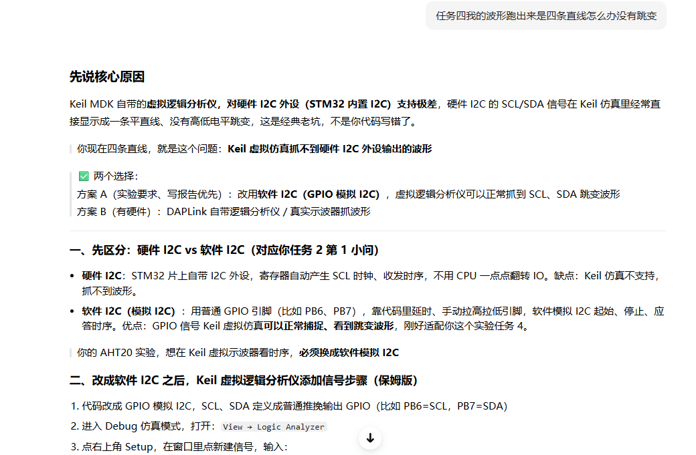

